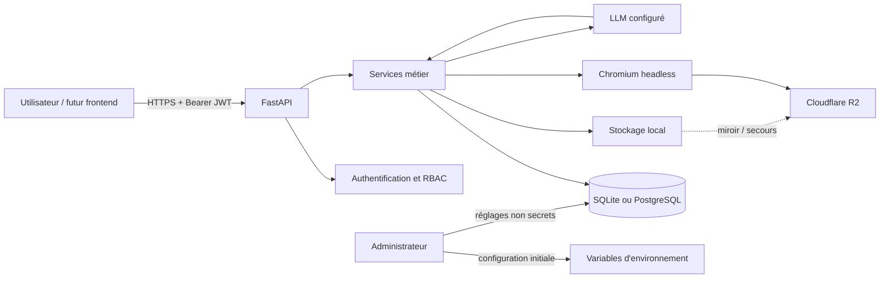

# Architecture de FaktSure

Ce document décrit l'architecture réellement présente dans le dépôt. Le système livré est un backend monolithique FastAPI.

## Vue d'ensemble



Le navigateur appelle l'API ; il ne communique jamais directement avec la base, R2 ou le fournisseur LLM. L'API authentifie l'utilisateur, applique les permissions, orchestre les services, valide les résultats et écrit les événements d'audit.

## Modules

| Module | Responsabilité |
|---|---|
| `backend/app/main.py` | Construction de l'application, middleware CORS, lifespan, santé et schéma OpenAPI français. |
| `backend/app/api/v1/endpoints/` | Routes FastAPI, validation des paramètres et contrôle des rôles. |
| `backend/app/schemas/` | Contrats Pydantic des entrées et sorties. |
| `backend/app/core/` | Configuration, JWT et mots de passe, permissions, erreurs et réglages runtime. |
| `backend/app/models/` | Modèles SQLAlchemy et relations persistées. |
| `backend/app/services/` | Cas d'usage : documents et lots, extraction, validation, calculs, factures, PDF, audit. |
| `backend/app/extractors/` | Classification des fichiers et extraction de texte PDF via PyMuPDF. |
| `backend/app/ai/` | Interface LLM et fournisseurs interchangeables Gemini, Groq et Cloudflare. |
| `backend/app/validators/` | Détection d'anomalies documentaires, de référence et de cohérence. |
| `backend/app/storage/` | Stockage local, client R2 et coordination des sauvegardes et lectures. |
| `backend/app/templates/invoices/` et `app/static/invoice/` | HTML/CSS de facture, marque et polices locales pour Chromium. |
| `backend/alembic/` | Migrations de schéma (7 révisions) ; le conteneur les applique avant le démarrage de l'API. |
| `backend/tests/` | Tests unitaires et d'intégration API/workflow (48 tests). |

## Flux de traitement

### Import et extraction

1. `POST /api/batches` crée un lot.
2. L'import contrôle la taille, le type MIME et la signature réelle, calcule le SHA-256 et détecte les doublons.
3. Le document original est écrit dans le stockage local ; si R2 est configuré et actif, une copie distante est aussi tentée.
4. Le détecteur classe chaque fichier par signature et contenu : `NATIVE_PDF`, `MIXED_PDF`, `SCANNED_PDF`, `IMAGE` ou `UNSUPPORTED`.
5. Les PDF natifs admissibles passent par PyMuPDF pour le texte, puis par le fournisseur LLM pour la structure métier.
6. Les valeurs sont persistées comme `ExtractedField`, avec confiance et éléments de preuve (page, texte, coordonnées) lorsqu'ils sont retrouvés dans le document.
7. Les validateurs comparent les données aux référentiels et créent ou mettent à jour les anomalies.

Le traitement des lots est déclenché explicitement et s'exécute séquentiellement dans le processus API, par groupes de `DOCUMENT_BATCH_SIZE` documents (3 par défaut). Il ne s'agit pas d'une file durable externe. La reprise de certains états est effectuée au démarrage, mais l'architecture de démonstration doit rester à une seule instance.

### Règles d'anomalies

Le moteur est déterministe et réside dans `backend/app/validators/` : chaque règle est explicable, reproductible et testée unitairement. Gravités et règles :

| Anomalie | Gravité | Règle appliquée |
|---|---|---|
| `MISSING_REQUIRED_FIELD` | `BLOCKER` | Champ obligatoire absent ou aucune ligne extraite |
| `DUPLICATE_DOCUMENT` | `BLOCKER` | Empreinte SHA-256 identique à un document déjà présent |
| `DUPLICATE_ORDER` | `BLOCKER` | Numéro de document déjà traité par une facture non annulée |
| `CONTRADICTORY_FIELD` | `BLOCKER` | Date invalide, échéance antérieure, total de ligne incohérent ou ligne illisible |
| `TOTAL_MISMATCH` | `BLOCKER` | Sous-total ou total incompatible avec les lignes (tolérance 0,01) |
| `LOW_CONFIDENCE` | `WARNING` | Confiance inférieure à 0,5 ou valeur non retrouvée dans le texte source |
| `CLIENT_UNKNOWN` | `WARNING` | Client absent du référentiel actif ; suggestion floue au-delà de 0,6 de similitude |
| `PRODUCT_UNKNOWN` | `WARNING` | Produit absent du référentiel actif ; suggestion floue au-delà de 0,6 |
| `PRICE_MISMATCH` | `WARNING` | Prix extrait différent du prix de référence valide à la date du document |
| `CURRENCY_MISMATCH` | `WARNING` | Devise du document différente de celle du prix de référence |
| `QUANTITY_UNUSUAL` | `WARNING` | Quantité négative, nulle ou supérieure à 1 000 |

Un bloqueur ne peut pas être contourné par une validation : il est levé par une correction du champ lié, qui relance le moteur et vérifie que l'anomalie disparaît. Les avertissements ne bloquent pas, mais leur décision humaine est consignée dans l'audit.

### États du workflow

| Objet | États |
|---|---|
| Document | `UPLOADED`, `QUEUED`, `EXTRACTING`, `READY`, `FAILED`, `REJECTED` |
| Lot | `CREATED`, `PROCESSING`, `COMPLETED`, `PARTIALLY_COMPLETED` |
| Facture | `DRAFT`, `ISSUED`, `CANCELLED` |
| Anomalie | `OPEN`, `RESOLVED` (gravités `BLOCKER` et `WARNING`) |

Au démarrage, la routine de récupération remet en `QUEUED` les documents restés en `EXTRACTING` après un arrêt brutal, puis ré-enfile ou clôture les lots `PROCESSING`.

### Revue et facturation

Un humain examine les champs et anomalies, corrige si nécessaire, puis confirme ou rejette le document. Une anomalie `BLOCKER` ouverte empêche l'état `READY` et la création de facture. La revue exige une confirmation explicite ; corriger un champ après la revue l'invalide et exige une nouvelle confirmation.

Le brouillon est calculé par le backend avec `Decimal` ; les montants envoyés par le navigateur ne font pas autorité. Les taux de TVA sont lus dans les règles configurées et validés contre leur période et leur état actif. Les remises sont déduites avant le calcul des taxes ; la formule vérifiée est :

```text
grand_total = subtotal - discount_total + tax_total
```

Une facture utilise soit des règles de TVA par ligne, soit une règle globale unique. Le mode global persiste son `tax_rule_id` au niveau de l'enregistrement `Invoice` ; les règles par ligne sont conservées sur `InvoiceItem`. Ces deux modes sont exclusifs.

À l'émission, le service protège l'attribution du numéro `FS-AAAA-NNNNNN` contre les émissions répétées ou concurrentes, vérifie le workflow et produit un PDF. Il écrit le PDF essentiel dans R2 avant de marquer la facture comme émise ; si cette écriture échoue, l'émission échoue. Le PDF stocke un hash et une version de format, et peut être régénéré lors d'une évolution du rendu.

## Modèle de données

Principales entités SQLAlchemy :

- `User` : compte, hash du mot de passe, rôle et état actif.
- `DocumentBatch` : lot et progression agrégée.
- `Document` : type et état, fichier source, empreinte SHA-256, stockage et erreurs.
- `ExtractedField` : valeur originale et corrigée, confiance, preuves de page, de texte et coordonnées.
- `Anomaly` : type, gravité, état, résolution et auteur.
- `Client`, `Product`, `ProductPrice`, `TaxRule` : référentiels et périodes de validité.
- `Invoice` et `InvoiceItem` : facture, dates, montants, TVA globale éventuelle et lignes.
- `InvoiceSequence` : séquence annuelle des numéros définitifs.
- `AuditLog` : acteur, action, ressource et changements ou décisions.
- `AppSetting` : réglages non secrets administrables, persistés comme paires clé/valeur.

L'API expose des UUID `public_id` ; les identifiants numériques servent aux clés et relations internes. Les sept migrations Alembic assurent l'évolution du schéma sans recréer la base. Pour la migration qui ajoute la TVA globale, `alembic upgrade head` doit être appliqué à toute base existante avant d'utiliser une version du code qui lit `invoices.tax_rule_id`.

## Identité, permissions et audit

Le login vérifie le hash du mot de passe et délivre un JWT signé par `JWT_SECRET`. Chaque requête protégée résout un utilisateur actif ; `require_roles` compare son rôle aux rôles autorisés sur la route.

Permissions principales :

- `ADMIN` : utilisateurs, paramètres, consultation de l'audit, écriture de tous les référentiels, et tous les traitements documentaires.
- `ACCOUNTANT` : lots, extraction, corrections et revue des documents, préparation des brouillons ; lecture seule des référentiels.
- `VALIDATOR` : lecture des documents et factures, revue ou rejet, émission des factures ; ni audit ni écriture des référentiels.

Les actions importantes (login, opérations documentaires, factures, réglages émetteur, gestion des utilisateurs) écrivent dans `AuditLog`. Les secrets d'API et les mots de passe ne sont ni journalisés ni exposés.

## Configuration et priorités

`app/core/config.py` lit l'environnement et le `.env` local. Le conteneur Docker définit les valeurs propres au conteneur (Chromium, stockage). Les clés LLM et R2 et le secret JWT restent des variables de déploiement.

`AppSetting` et `runtime_settings.py` chargent au démarrage les réglages dynamiques non secrets : limites de traitement, fournisseur et modèles, activation R2 et coordonnées de l'émetteur. Les valeurs émetteur mises à jour via l'API prennent le pas sur les variables `ISSUER_*`. Les credentials ne sont pas modifiables depuis l'API.

CORS est fermé par défaut. `CORS_ALLOWED_ORIGINS` accepte des origines HTTP(S) explicites, séparées par virgules ; wildcard, chemins et credentials d'URL sont refusés. `allow_credentials` reste désactivé puisque l'API utilise Bearer JWT.

## Persistance et stockage

### Base relationnelle

- Développement par défaut : SQLite local.
- Démonstration Railway : SQLite sur un volume persistant, une seule instance.
- Essai local Compose : PostgreSQL 17 et volume Docker dédié.
- Déploiement plus robuste : PostgreSQL recommandé ; le code SQLAlchemy/Alembic prend en charge cette trajectoire.

SQLite sur volume Railway est une configuration de démonstration, pas un dispositif de haute disponibilité. Le service ne doit pas être répliqué horizontalement avec le traitement en mémoire actuel.

### Fichiers

Le stockage local utilise `STORAGE_ROOT`. Lorsque R2 est activé pour les documents ordinaires, le fichier est gardé localement et une copie distante est tentée ; une défaillance R2 est journalisée et le fichier local reste disponible.

Les PDF de factures émises sont différents : R2 est requis pour la persistance essentielle. Le PDF doit être écrit avec succès dans R2 avant l'émission ; une copie locale miroir est tentée ensuite. Les lectures vérifient l'empreinte SHA-256 et peuvent utiliser la copie locale en secours selon le backend et sa disponibilité.

## Génération PDF

`invoice_pdf.py` prépare le contexte depuis la facture, ses lignes, les référentiels et les réglages effectifs. Jinja rend `app/templates/invoices/facture.html` ; le CSS et les polices sont locaux ; Chromium headless imprime le PDF sans accès réseau.

Le brouillon porte un filigrane de brouillon sur chaque page, et une étiquette distingue `FACTURE` de `BROUILLON`. Le PDF émis comporte le numéro définitif, les coordonnées disponibles, les dates et conditions de paiement, les lignes, les remises, le récapitulatif et la TVA. Le format est versionné pour permettre de régénérer les pièces devenues obsolètes selon la politique du service.

## Déploiement

L'image `backend/Dockerfile` installe Python 3.12, Chromium et les dépendances. Elle s'exécute par défaut sous un utilisateur non-root et l'entrypoint exécute :

```text
alembic upgrade head
uvicorn app.main:app --host 0.0.0.0 --port ${PORT:-8000}
```

Le Compose racine est un environnement local avec PostgreSQL, volume de documents et contrôle de santé. Railway a été utilisé pour la démonstration avec un volume monté sous `/data`, SQLite pour la base, `STORAGE_ROOT=/data/documents` et R2 pour les PDF émis. Ne pas réutiliser les identifiants PostgreSQL de Compose en production.

Avant de déployer une nouvelle version avec migration :

1. Faire une sauvegarde exploitable de la base et des fichiers persistants.
2. Déployer l'image ou la version de code qui correspond à la migration.
3. Vérifier les logs de démarrage et le health check.
4. Vérifier le niveau Alembic et les parcours concernés avant de rouvrir l'usage.

Ne jamais utiliser `alembic stamp head` pour faire disparaître une erreur de colonne : `stamp` modifie seulement la version déclarée et ne crée pas les colonnes manquantes. Utiliser `alembic upgrade head` pour appliquer les migrations réelles.

## Limites actuelles

- **Pas d'OCR effectif.** Les images et PDF scannés sont classés, mais l'extracteur disponible est destiné aux PDF natifs textuels.
- **Pas de file de tâches externe.** Les traitements vivent dans le processus API ; une seule instance est recommandée pour la démonstration.
- **Pas d'émission réglementaire réelle.** Le numéro et la facture sont émis par l'application ; aucune plateforme fiscale n'est appelée.
- **TVA paramétrable, conformité non garantie.** Les taux, exonérations, périodes, arrondis et mentions légales applicables doivent être confirmés par une personne compétente.
- **Mode global limité à une règle et un taux uniques.** Si une facture mélange plusieurs taux ou exonérations, utiliser le mode par ligne.
- **Aucune garantie de production sur le plan Railway de démonstration.** Prévoir PostgreSQL, sauvegardes, observabilité, politique de secrets, restauration et essais de charge avant une exploitation réelle.
- **Multi-entreprise non implémenté.** La configuration de l'émetteur est globale à une instance.
