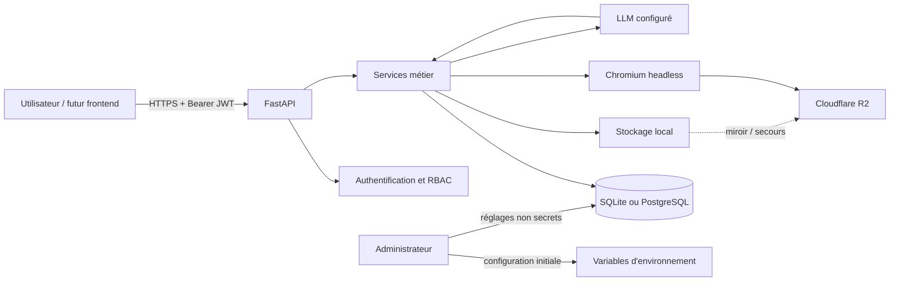

# Architecture de FaktSure

Ce document décrit l'architecture réellement présente dans le dépôt. Le système livré est un backend monolithique FastAPI; le frontend attendu n'est pas encore implémenté dans `frontend/`.

## Vue d'ensemble



Le navigateur appelle l'API; il ne communique pas directement avec la base, R2 ou le fournisseur LLM. L'API authentifie l'utilisateur, applique les permissions, orchestre les services, valide les résultats et écrit les événements d'audit.

## Modules

| Module | Responsabilité |
|---|---|
| `backend/app/main.py` | Construction de l'application, middleware CORS, lifespan, health check et schéma OpenAPI français. |
| `backend/app/api/v1/endpoints/` | Routes FastAPI, validation des paramètres et contrôle des rôles. |
| `backend/app/schemas/` | Contrats Pydantic des entrées/sorties. |
| `backend/app/core/` | Configuration, JWT/mots de passe, permissions, erreurs et réglages runtime. |
| `backend/app/models/` | Modèles SQLAlchemy et relations persistées. |
| `backend/app/services/` | Cas d'utilisation : documents/lots, extraction, validation, calculs, factures, PDF, audit. |
| `backend/app/extractors/` | Détection/classification et extraction de texte PDF via PyMuPDF. |
| `backend/app/ai/` | Interface LLM et fournisseurs interchangeables Gemini, Groq et Cloudflare. |
| `backend/app/validators/` | Détection d'anomalies documentaires, de référence et de cohérence. |
| `backend/app/storage/` | Stockage local, client R2 et coordination des sauvegardes/lectures. |
| `backend/app/templates/invoices/` et `app/static/invoice/` | HTML/CSS de facture, marque et polices locales pour Chromium. |
| `backend/alembic/` | Migrations de schéma; le conteneur les applique avant le démarrage de l'API. |
| `backend/tests/` | Tests unitaires et d'intégration API/workflow. |

## Flux de traitement

### Import et extraction

1. `POST /api/batches` crée un lot.
2. L'upload contrôle la taille, le type MIME et la signature réelle, calcule le SHA-256 et détecte les doublons.
3. Le document original est écrit dans le stockage local; si R2 est configuré et actif, une copie distante est aussi tentée.
4. Les PDF natifs admissibles sont envoyés à PyMuPDF pour extraire le texte, puis au fournisseur LLM pour obtenir une structure métier.
5. Les valeurs sont persistées comme `ExtractedField`, avec confiance et éléments source lorsqu'ils sont retrouvés dans le texte.
6. Les validateurs comparent données et référentiels, puis créent ou mettent à jour les anomalies.

Le traitement des lots est déclenché explicitement et exécuté séquentiellement dans le processus API. Il ne s'agit pas d'une file durable externe. La reprise de certains lots est effectuée au démarrage, mais l'architecture de démonstration doit rester à une seule instance.

### Revue et facturation

Un humain examine les champs et anomalies, corrige si nécessaire, puis confirme ou rejette le document. Une anomalie bloquante empêche la revue prête et la création de facture.

Le brouillon est calculé par le backend avec `Decimal`; les montants ne sont pas acceptés comme source d'autorité depuis le navigateur. Les taux de TVA sont lus dans les règles configurées et validés contre leur période et leur état actif. Les remises sont déduites avant le calcul des taxes; la formule vérifiée est :

```text
grand_total = subtotal - discount_total + tax_total
```

Une facture utilise soit des règles de TVA par ligne, soit une règle globale unique. Le modèle global persiste son `tax_rule_id` au niveau de l'enregistrement `Invoice`; les règles par ligne sont conservées sur `InvoiceItem`. Ces deux modes sont exclusifs.

À l'émission, le service protège l'attribution du numéro contre les émissions répétées/concurrentes, vérifie le workflow et produit un PDF. Il écrit le PDF essentiel dans R2 avant de marquer la facture comme émise; si cette étape échoue, l'émission échoue. Le PDF stocke un hash et la version de format, et peut être régénéré lors d'une évolution du rendu.

## Modèle de données

Principales entités SQLAlchemy :

- `User` : compte, hash du mot de passe, rôle et état actif.
- `DocumentBatch` : lot et progression agrégée.
- `Document` : type/état, fichier source, empreinte SHA-256, stockage et erreurs.
- `ExtractedField` : valeur originale/corrigée, confiance, source page/texte/coordonnées.
- `Anomaly` : type, gravité, état, résolution et auteur.
- `Client`, `Product`, `ProductPrice`, `TaxRule` : référentiels et périodes de validité.
- `Invoice` et `InvoiceItem` : facture, dates, montants, TVA globale éventuelle et lignes.
- `InvoiceSequence` : séquence annuelle des numéros définitifs.
- `AuditLog` : acteur, action, ressource et changements/décisions.
- `AppSetting` : réglages non secrets administrables persistés comme paires clé/valeur.

L'API expose des UUID `public_id`; les IDs numériques servent aux clés et relations internes. Des migrations Alembic assurent l'évolution du schéma sans recréer la base. Pour la migration ajoutant la TVA globale, `alembic upgrade head` doit être appliqué à toute base existante avant d'utiliser la version du code qui lit `invoices.tax_rule_id`.

## Identité, permissions et audit

Le login vérifie le hash du mot de passe et délivre un JWT signé par `JWT_SECRET`. Chaque requête protégée résout un utilisateur actif; `require_roles` compare son rôle aux rôles autorisés sur la route.

Permissions principales :

- `ADMIN` : utilisateurs, paramètres, consultation audit, écriture de tous les référentiels.
- `ACCOUNTANT` : import/traitement/correction/revue des documents et préparation de brouillons; lecture seule des référentiels.
- `VALIDATOR` : lecture, revue/rejet de document et émission de facture; pas d'accès à l'audit ni à l'écriture des référentiels.

Les actions importantes (login, opérations documentaires, factures, réglages émetteur, gestion utilisateurs) peuvent écrire dans `AuditLog`. Les secrets d'API et mots de passe ne doivent pas être journalisés ou exposés.

## Configuration et priorités

`app/core/config.py` lit l'environnement et `.env` local. Le conteneur Docker définit les valeurs Chromium et stockage locales au conteneur. Les clés LLM/R2 et le secret JWT restent des variables de déploiement.

`AppSetting` et `runtime_settings.py` chargent au démarrage les réglages non secrets dynamiques : limites de traitement, fournisseur/modèles, activation R2 et coordonnées de l'émetteur. Les valeurs émetteur mises à jour via API prennent le pas sur `ISSUER_*`. Les credentials ne sont pas modifiables depuis l'API.

CORS est fermé par défaut. `CORS_ALLOWED_ORIGINS` accepte des origines HTTP(S) explicites séparées par des virgules; wildcard, chemins et credentials d'URL sont refusés. `allow_credentials` reste désactivé puisque l'API utilise Bearer JWT.

## Persistance et stockage

### Base relationnelle

- Développement par défaut : SQLite local.
- Démonstration Railway : SQLite sur un volume persistant, une seule instance.
- Essai local Compose : PostgreSQL 17 et volume Docker dédié.
- Déploiement plus robuste : PostgreSQL recommandé; le code SQLAlchemy/Alembic prend en charge cette trajectoire.

SQLite sur volume Railway est une configuration de démonstration, non un dispositif haute disponibilité. Le service ne doit pas être répliqué horizontalement avec le traitement mémoire actuel.

### Fichiers

Le stockage local utilise `STORAGE_ROOT`. Lorsque R2 est activé pour les documents ordinaires, le fichier est gardé localement et une copie distante est tentée; une défaillance R2 est journalisée et le fichier local reste disponible.

Les PDF de factures émises sont différents : R2 est requis pour la persistance essentielle. Le PDF doit être écrit avec succès dans R2 avant l'émission; une copie miroir locale est tentée ensuite. Les lectures vérifient l'empreinte SHA-256 et peuvent utiliser la copie locale en secours selon le backend et sa disponibilité.

## Génération PDF

`invoice_pdf.py` prépare le contexte depuis la facture, ses lignes, les référentiels et les réglages effectifs. Jinja rend `app/templates/invoices/facture.html`; CSS et polices sont locaux; Chromium headless imprime le PDF sans dépendance à un chargement de polices réseau.

Le brouillon porte un filigrane « BROUILLON — NON ÉMISE ». Le PDF émis comporte le numéro définitif, les coordonnées disponibles, dates/conditions de paiement, lignes, remises, récapitulatif et TVA. Le format est versionné pour permettre de régénérer les pièces devenues obsolètes selon la politique du service.

## Déploiement

L'image `backend/Dockerfile` installe Python 3.12, Chromium et les dépendances. Elle s'exécute par défaut sous un utilisateur non-root et l'entrypoint exécute :

```text
alembic upgrade head
uvicorn app.main:app --host 0.0.0.0 --port ${PORT:-8000}
```

Le Compose racine est un environnement local avec PostgreSQL, volume de documents et health check. Railway a été utilisé pour la démonstration avec un volume monté sous `/data`, SQLite pour la base, `STORAGE_ROOT=/data/documents` et R2 pour les PDF émis. Ne pas réutiliser les identifiants PostgreSQL de Compose en production.

Avant déploiement d'une nouvelle version avec migration :

1. Faire une sauvegarde exploitable de la base et des fichiers persistants.
2. Déployer l'image/version de code correspondant à la migration.
3. Vérifier les logs de démarrage et le health check.
4. Vérifier le niveau Alembic et les parcours concernés avant de rouvrir l'usage.

Ne jamais utiliser `alembic stamp head` pour faire disparaître une erreur de colonne : `stamp` modifie seulement la version déclarée et ne crée pas les colonnes manquantes. Utiliser `alembic upgrade head` pour appliquer les migrations réelles.

## Limites actuelles et décisions métier à confirmer

- **Pas de frontend livré.** L'interface devra consommer l'API et respecter la matrice RBAC.
- **Pas d'OCR effectif.** Les images/PDF scannés sont classés, mais l'extracteur disponible est destiné aux PDF natifs textuels.
- **Pas de file de tâches externe.** Les traitements vivent dans le processus API; une instance est recommandée pour la démo.
- **Pas d'émission réglementaire réelle.** Le numéro et la facture sont émis par l'application; aucune plateforme fiscale n'est appelée.
- **TVA paramétrable, conformité non garantie.** Il faut faire confirmer par une personne compétente les taux, exonérations, périodes, arrondis et mentions légales applicables.
- **Mode global limité à une règle/taux unique.** Si une facture a plusieurs taux/exonérations, choisir le mode par ligne.
- **Aucune garantie de production sur le plan Railway démo.** Prévoir PostgreSQL, sauvegardes, observabilité, politique de secrets, restauration et tests de charge avant l'exploitation réelle.
- **Multi-entreprise non implémenté.** La configuration de l'émetteur est globale à une instance.
