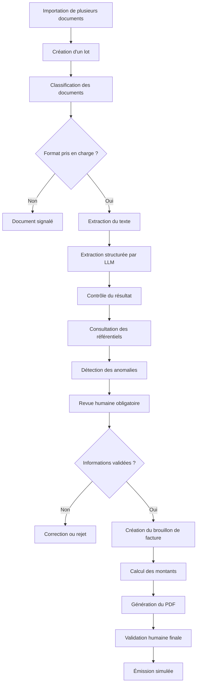
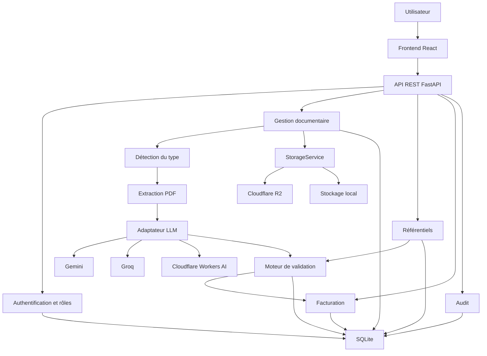
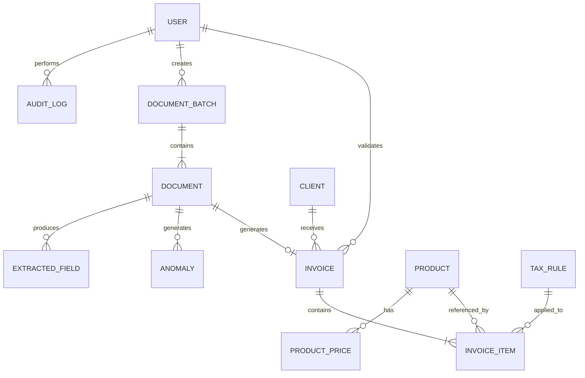

# FaktSure
## Document de spécifications fonctionnelles et techniques

**Projet de hackathon BWAI 2026 | Automatisation de la facturation**

**Équipe :** FaktSure Team  
**Date :** 25 novembre 2026  

---

# 1. Présentation du projet

## 1.1. Contexte

Dans le cadre du hackathon, l'équipe travaille sur le second sujet proposé : **Automatisation de la facturation**.

Le projet consiste à concevoir une plateforme intelligente capable d'automatiser une partie importante du processus de facturation, depuis la réception des documents commerciaux jusqu'à la préparation et à la validation des factures.

Dans de nombreuses organisations, la préparation des factures repose encore sur des opérations manuelles :

- Lecture des bons de commande et autres documents commerciaux.
- Recopie des informations relatives aux clients et aux produits.
- Vérification des quantités et des prix.
- Calcul des montants et des taxes.
- Recherche des incohérences.
- Préparation des factures.
- Vérification et validation avant émission.

Ces opérations peuvent être longues et répétitives. Elles peuvent également entraîner des erreurs de saisie, des incohérences financières, des doublons et des retards dans le traitement des dossiers.

L'utilisation de l'intelligence artificielle permet d'automatiser une partie de ces tâches, notamment la compréhension des documents et l'extraction des informations utiles.

Cependant, une automatisation complète sans contrôle peut également produire des erreurs. Une information mal interprétée ou un montant incorrect peut avoir des conséquences financières.

Le système doit donc associer l'intelligence artificielle à des contrôles métier déterministes et à une validation humaine obligatoire.

## 1.2. Présentation de la solution

**FaktSure** est une plateforme intelligente d'automatisation de la facturation.

Elle permet d'importer plusieurs documents commerciaux, de les analyser automatiquement, d'en extraire les informations importantes, de vérifier leur cohérence avec les référentiels de l'entreprise et de préparer des factures.

L'utilisateur conserve le contrôle du processus. Chaque document doit faire l'objet d'une vérification humaine avant de pouvoir servir à la facturation.

La plateforme ne se limite donc pas à extraire du texte d'un PDF. Elle cherche à transformer un document commercial en un dossier de facturation structuré, vérifiable et traçable.

### Principe fondamental

**L'intelligence artificielle extrait les informations, le backend effectue les contrôles métier et l'utilisateur prend les décisions de validation.**

## 1.3. Problématique

Comment automatiser la préparation des factures à partir de documents commerciaux tout en garantissant la cohérence des informations, la fiabilité des calculs et le contrôle humain avant émission ?

## 1.4. Proposition de valeur

FaktSure vise à :

- Réduire le temps consacré à la préparation des factures.
- Limiter les erreurs de saisie manuelle.
- Faciliter le traitement de plusieurs documents.
- Identifier les incohérences avant la facturation.
- Améliorer la traçabilité des opérations.
- Permettre aux utilisateurs de contrôler les informations extraites.
- Faciliter la production de factures cohérentes et vérifiables.

---

# 2. Vision et objectifs

## 2.1. Objectif général

Développer une plateforme intelligente capable d'automatiser le traitement de documents commerciaux et la préparation de factures, en combinant extraction par intelligence artificielle, validation métier et contrôle humain.

## 2.2. Objectifs spécifiques

Le système doit permettre de :

1. Importer plusieurs documents commerciaux en une seule opération.
2. Identifier automatiquement le type de chaque document.
3. Extraire les informations utiles à partir des documents pris en charge.
4. Utiliser plusieurs fournisseurs LLM interchangeables.
5. Évaluer la qualité des informations extraites.
6. Comparer les informations extraites aux référentiels de l'entreprise.
7. Détecter les incohérences et les anomalies.
8. Permettre la correction manuelle des informations.
9. Générer des brouillons de factures.
10. Calculer automatiquement les montants et les taxes.
11. Générer des factures au format PDF.
12. Imposer une validation humaine avant émission.
13. Conserver un historique des opérations.
14. Garantir l'intégrité et la disponibilité des documents originaux.

## 2.3. Utilisateurs cibles

La solution s'adresse principalement aux entreprises et organisations qui souhaitent améliorer leur processus de facturation, notamment les services :

- Comptabilité.
- Administration.
- Gestion commerciale.
- Gestion des commandes.
- Contrôle et validation financière.

---

# 3. Périmètre fonctionnel

Le développement est organisé autour de trois catégories.

## 3.1. Fonctionnalités obligatoires du MVP

Les fonctionnalités suivantes constituent le périmètre prioritaire du hackathon.

| Domaine | Fonctionnalités |
|---|---|
| Utilisateurs | Gestion des utilisateurs et des rôles |
| Référentiels | Gestion des clients et des produits |
| Importation | Importation multiple de documents |
| Classification | Identification du type de fichier |
| Extraction | Extraction structurée par LLM |
| Qualité | Indicateurs de confiance et informations incertaines |
| Validation métier | Contrôle des informations extraites |
| Anomalies | Détection des incohérences |
| Revue humaine | Consultation et correction des informations |
| Facturation | Création de brouillons de factures |
| Calculs | Calcul automatique des montants et taxes |
| PDF | Génération des factures |
| Validation | Approbation humaine obligatoire |
| Stockage | Cloudflare R2 et stockage local |
| Audit | Historique des opérations |
| Tests | Tests fonctionnels et techniques |

## 3.2. Fonctionnalités prévues en extension

Ces fonctionnalités sont prises en compte dans la conception, mais leur réalisation dépendra du temps disponible.

- OCR des documents numérisés.
- Traitement des PDF mixtes.
- Extraction à partir d'images.
- Mise en évidence des zones sources dans le PDF lorsqu'un utilisateur sélectionne un champ.
- Comparaison automatique entre bons de commande et bons de livraison.
- Gestion des avoirs.
- Importation avancée des référentiels Excel.
- Synchronisation avec des systèmes ERP.
- Notifications automatiques.
- Traitement parallèle plus avancé.
- Gestion de plusieurs entreprises.
- Statistiques et tableaux de bord avancés.

## 3.3. Fonctionnalités hors périmètre

Les fonctionnalités suivantes ne seront pas développées dans le cadre du MVP :

- Émission réelle de factures auprès d'une administration fiscale.
- Intégration réelle à une plateforme Mobile Money ou bancaire.
- Intégration complète à un ERP.
- Chatbot généraliste.
- Système RAG autonome.
- Comptabilité générale complète.
- Gestion complète des stocks.
- Reconnaissance de tous les formats de documents.
- Automatisation de la validation financière sans intervention humaine.

---

# 4. Description détaillée des fonctionnalités

## 4.1. Gestion des utilisateurs

La plateforme doit permettre d'identifier les utilisateurs et de contrôler leurs droits.

Les rôles principaux sont :

- Administrateur.
- Comptable.
- Validateur.

Chaque opération importante doit être associée à l'utilisateur qui l'a effectuée.

## 4.2. Gestion des référentiels

L'entreprise doit pouvoir constituer ses propres référentiels.

Les informations doivent être disponibles avant le traitement des documents afin de permettre les contrôles métier.

Deux méthodes d'alimentation sont obligatoires :

1. Saisie manuelle depuis l'interface.
2. Importation de fichiers CSV ou Excel.

Les référentiels comprennent notamment :

- Clients.
- Produits.
- Prix de référence.
- Règles fiscales.
- Conditions de paiement.

## 4.3. Importation multiple de documents

L'utilisateur doit pouvoir sélectionner plusieurs fichiers et les importer en une seule opération.

L'importation crée un lot de traitement.

Chaque document doit être enregistré individuellement avec :

- Son nom original.
- Son type MIME.
- Sa taille.
- Son empreinte SHA-256.
- Sa date d'importation.
- Son emplacement de stockage.
- Son état de traitement.

L'application doit vérifier les formats acceptés et éviter les doublons.

Un document identique déjà présent dans le système ne doit pas être traité silencieusement comme un nouveau document.

## 4.4. Traitement par groupes

Le système doit organiser les documents en groupes de trois.

Exemple pour un lot de dix documents :

| Groupe | Documents |
|---|---|
| Groupe 1 | Documents 1, 2 et 3 |
| Groupe 2 | Documents 4, 5 et 6 |
| Groupe 3 | Documents 7, 8 et 9 |
| Groupe 4 | Document 10 |

Le nombre de documents par groupe doit être configurable.

Pour le MVP, le traitement sera séquentiel à l'intérieur de chaque groupe. Une évolution vers un traitement parallèle pourra être envisagée après les essais des fournisseurs LLM.

L'interface doit afficher la progression du lot et l'état de chaque document.

## 4.5. Classification automatique des documents

Avant toute extraction, le système doit identifier la nature réelle du fichier.

Les catégories prévues sont :

| Type | Description | Traitement MVP |
|---|---|---|
| NATIVE_PDF | PDF contenant du texte exploitable | Pris en charge |
| SCANNED_PDF | PDF constitué principalement d'images | Identifié, OCR reporté |
| MIXED_PDF | PDF contenant des pages textuelles et des pages numérisées | Identifié, traitement avancé reporté |
| IMAGE | Image JPG ou PNG | Identifiée, OCR/Vision reporté |
| UNSUPPORTED | Format non pris en charge | Refus explicite |

La classification ne doit pas se baser uniquement sur l'extension du fichier.

Le système doit examiner le contenu réel du fichier et la présence de texte exploitable dans les pages.

La classification doit également permettre d'identifier les PDF mixtes, page par page lorsque cela est nécessaire.

## 4.6. Extraction des informations

Pour les PDF natifs, le système doit extraire le texte avec PyMuPDF.

Le texte extrait est ensuite transmis au fournisseur LLM configuré.

L'objectif est d'obtenir une représentation structurée des informations commerciales.

Les informations recherchées comprennent notamment :

**Informations générales :**
- Numéro du document.
- Type du document.
- Date du document.
- Date d'échéance éventuelle.
- Devise.
- Conditions de paiement.

**Informations relatives au client :**
- Nom ou raison sociale.
- Identifiant fiscal éventuel.
- Adresse.
- Coordonnées disponibles.

**Informations relatives aux articles :**
- Désignation.
- Référence ou code produit.
- Quantité.
- Unité.
- Prix unitaire.
- Remise éventuelle.
- Montant de la ligne.

**Informations financières :**
- Total hors taxes.
- Montant des taxes.
- Remises globales.
- Total toutes taxes comprises.

Les informations absentes doivent être représentées par `null`.

Le système ne doit jamais inventer une information pour compléter un document.

## 4.7. Gestion des informations incertaines

Toutes les informations extraites ne présentent pas le même niveau de fiabilité.

Le système doit distinguer :

- Information fiable.
- Information incertaine.
- Information absente.
- Information contradictoire.

Un indicateur de confiance doit être associé aux champs extraits.

Cet indicateur est une estimation interne de la qualité de l'extraction. Il ne doit pas être présenté comme une probabilité statistique calibrée.

La décision finale ne doit pas dépendre uniquement du score fourni par le LLM.

Elle doit aussi prendre en compte :

- La présence d'une preuve textuelle.
- La conformité au schéma attendu.
- La cohérence des données.
- La concordance avec les référentiels.
- La présence de contradictions.

Un champ incertain doit être signalé à l'utilisateur.

## 4.8. Traçabilité des informations extraites

Pour chaque champ important, le système doit conserver les informations permettant de retrouver son origine.

Exemple :

```json
{
  "field_name": "unit_price",
  "value": 350000,
  "confidence": 0.96,
  "status": "RELIABLE",
  "source": {
    "page": 1,
    "text": "Prix unitaire : 350 000 FCFA",
    "bbox": null
  }
}
```

Les coordonnées `bbox` sont prévues pour une évolution permettant de surligner la zone correspondante dans le PDF.

Le LLM ne doit pas inventer ces coordonnées. Elles doivent être obtenues à partir du document original et de ses positions textuelles.

---

# 5. Workflow général de traitement

Le parcours principal de FaktSure est le suivant :



## 5.1. Étapes du workflow

**Étape 1 : Importation**

L'utilisateur importe plusieurs documents. Le système crée un lot et enregistre chaque fichier.

**Étape 2 : Classification**

Chaque document est analysé afin d'identifier son format et son contenu.

**Étape 3 : Extraction**

Le texte est extrait puis transmis au fournisseur LLM configuré.

**Étape 4 : Structuration**

Le résultat est converti en données structurées conformes au schéma attendu.

**Étape 5 : Contrôles métier**

Le backend consulte les référentiels et effectue les vérifications nécessaires.

**Étape 6 : Détection des anomalies**

Les incohérences sont identifiées et classées selon leur gravité.

**Étape 7 : Revue humaine**

L'utilisateur examine chaque document et corrige les informations si nécessaire.

Cette étape est obligatoire pour tous les documents, même ceux qui ne présentent aucune anomalie.

**Étape 8 : Création de la facture**

Le système génère un brouillon à partir des données vérifiées.

**Étape 9 : Calculs**

Le backend calcule les montants, les remises et les taxes selon les règles configurées.

**Étape 10 : Génération du PDF**

Une représentation PDF de la facture est produite.

**Étape 11 : Validation finale**

Un utilisateur disposant du rôle approprié valide la facture.

**Étape 12 : Émission simulée**

Le système attribue un numéro de facture et enregistre son état final.

Aucune émission fiscale réelle n'est effectuée.

---

# 6. Intelligence artificielle et extraction documentaire

## 6.1. Architecture multi-fournisseurs

FaktSure doit pouvoir utiliser différents fournisseurs LLM.

Trois fournisseurs seront évalués :

- Google Gemini.
- Groq.
- Cloudflare Workers AI.

Le choix du fournisseur doit être configurable.

La logique métier ne doit pas dépendre directement d'un fournisseur particulier.

Une interface commune sera utilisée :

```python
class LLMProvider:
    """Interface commune des fournisseurs de modèles."""

    def extract(self, document_text: str) -> dict:
        """Extrait les informations structurées d'un document."""
        raise NotImplementedError
```

Cette représentation illustre le principe d'abstraction. L'implémentation réelle devra utiliser des types de données précis, des schémas Pydantic et une gestion explicite des erreurs.

Chaque fournisseur aura son propre adaptateur.

## 6.2. Configuration

Exemple de configuration :

```env
LLM_PROVIDER=gemini

GEMINI_API_KEY=
GROQ_API_KEY=

CLOUDFLARE_ACCOUNT_ID=
CLOUDFLARE_API_TOKEN=
```

Les modèles seront sélectionnés après des tests comparatifs.

## 6.3. Comparaison des fournisseurs

Les trois fournisseurs doivent être évalués sur les mêmes documents et avec les mêmes instructions.

Les critères de comparaison sont :

- Exactitude des champs extraits.
- Respect du format JSON attendu.
- Gestion des informations absentes.
- Détection des ambiguïtés.
- Temps de réponse.
- Taux d'échec.
- Disponibilité des quotas gratuits.
- Coût éventuel.

Il faudra utiliser des documents représentatifs, y compris des documents contenant des erreurs ou des informations ambiguës.

## 6.4. Séparation entre extraction et validation

Cette séparation est fondamentale.

Le LLM est responsable de la compréhension du document et de l'extraction des informations.

Le backend est responsable des contrôles métier.

Exemple :

Un bon de commande indique :

- Produit : Écran HP.
- Quantité : 2.
- Prix unitaire : 110 000 FCFA.

Le référentiel contient un prix indicatif de 95 000 FCFA.

Le LLM extrait les informations du document.

Le backend consulte ensuite le référentiel et constate un écart.

Il génère une anomalie de type `PRICE_MISMATCH`.

Le LLM ne doit pas décider lui-même si le prix est acceptable.

Un écart de prix est généralement un avertissement et non un blocage automatique, car un prix négocié peut être différent du prix de référence.

---

# 7. Gestion des référentiels

## 7.1. Principe

Les référentiels sont fournis par l'entreprise qui utilise FaktSure.

Ils ne sont pas universels et ne doivent pas être inventés par l'intelligence artificielle.

Le système doit permettre leur alimentation par saisie manuelle ou importation de fichiers.

## 7.2. Référentiel clients

Informations possibles :

- Identifiant interne.
- Nom ou raison sociale.
- Identifiant fiscal.
- Adresse.
- Téléphone.
- Adresse électronique.
- Statut actif ou inactif.

## 7.3. Référentiel produits

Informations possibles :

- Identifiant interne.
- Code produit.
- Désignation.
- Description.
- Unité de mesure.
- Statut actif ou inactif.

## 7.4. Référentiel des prix

Les prix doivent être associés à des périodes de validité lorsque cela est nécessaire.

Informations possibles :

- Produit.
- Prix unitaire.
- Devise.
- Date de début de validité.
- Date de fin de validité.
- Liste tarifaire éventuelle.

Le système doit tenir compte de la date du document lors de la comparaison.

## 7.5. Règles fiscales

Les taux fiscaux doivent être paramétrables.

Le code ne doit pas imposer un taux unique.

Les règles peuvent notamment contenir :

- Libellé de la taxe.
- Taux.
- Nature de la taxe.
- Applicabilité.
- Période de validité.
- Mode de calcul.

Les règles fiscales réelles devront être configurées selon le contexte de l'entreprise et les dispositions applicables.

## 7.6. Importation CSV et Excel

L'importation doit permettre de charger des clients et des produits.

Le système doit :

- Vérifier les colonnes obligatoires.
- Vérifier les formats.
- Détecter les lignes incorrectes.
- Identifier les doublons.
- Présenter un résumé avant confirmation.
- Enregistrer les données valides.
- Signaler les lignes rejetées.

L'importation doit être transactionnelle autant que possible : une erreur ne doit pas laisser un référentiel dans un état incohérent.

---

# 8. Détection et gestion des anomalies

## 8.1. Objectif

Le système doit détecter les incohérences susceptibles de compromettre la fiabilité d'une facture.

Les anomalies doivent être produites par le moteur de validation métier, à partir des informations extraites et des référentiels.

## 8.2. Anomalies à détecter

| Anomalie | Description | Gravité initiale |
|---|---|---|
| CLIENT_UNKNOWN | Client absent du référentiel | WARNING |
| PRODUCT_UNKNOWN | Produit absent du référentiel | WARNING |
| PRICE_MISMATCH | Écart avec le prix de référence | WARNING |
| QUANTITY_UNUSUAL | Quantité inhabituelle | WARNING |
| DUPLICATE_DOCUMENT | Document déjà importé | BLOCKER |
| DUPLICATE_ORDER | Commande déjà facturée | BLOCKER |
| MISSING_REQUIRED_FIELD | Information obligatoire absente | BLOCKER |
| TOTAL_MISMATCH | Incohérence entre lignes et total | BLOCKER |
| CURRENCY_MISMATCH | Devise incohérente | WARNING |
| CONTRADICTORY_FIELD | Informations contradictoires | BLOCKER |
| LOW_CONFIDENCE | Extraction incertaine | WARNING |

Les niveaux de gravité doivent être configurables lorsque cela est pertinent.

## 8.3. Niveaux de gravité

Trois niveaux sont prévus :

**INFO**

Information à signaler, sans incidence directe sur la validation.

**WARNING**

Situation inhabituelle qui nécessite une attention humaine.

**BLOCKER**

Incohérence qui empêche la validation tant qu'elle n'est pas résolue.

Une anomalie bloquante ne doit pas pouvoir être ignorée par une simple validation.

## 8.4. Présentation des anomalies

L'interface doit afficher :

- Le type d'anomalie.
- Le champ concerné.
- La valeur extraite.
- La valeur de référence, lorsqu'elle existe.
- Une explication compréhensible.
- Le niveau de gravité.
- L'action attendue.

Exemple :

Produit : Écran HP

Prix extrait : 110 000 FCFA

Prix de référence : 95 000 FCFA

Écart : 15 000 FCFA

Anomalie : `PRICE_MISMATCH`

Gravité : WARNING

L'utilisateur peut examiner l'écart et confirmer le prix du document ou corriger l'information.

---

# 9. Gestion de la facturation

## 9.1. Création d'un brouillon

Une facture ne peut être créée qu'à partir d'un document dont les informations ont été vérifiées par un utilisateur.

Le brouillon doit contenir :

- Un client.
- Une date.
- Une devise.
- Une ou plusieurs lignes.
- Les quantités.
- Les prix unitaires.
- Les remises éventuelles.
- Les taxes applicables.
- Les totaux.

## 9.2. Calcul des montants

Les calculs sont réalisés exclusivement par le backend.

Pour une ligne :

Montant brut = Quantité × Prix unitaire.

Montant net taxable = Montant brut - Remise.

Montant de taxe = Base taxable × Taux applicable.

Total TTC = Sous-total - Remises + Total des taxes.

Le contrôle de cohérence d'un document applique la même règle : `grand_total = subtotal - discount_total + tax_total`. La remise est déduite avant le calcul des taxes lorsque celles-ci portent sur la base taxable remisée.

Pour le parcours actuel, la taxe de référence est la TVA. Une facture peut utiliser soit une règle de TVA rattachée à chaque ligne, soit une règle unique appliquée au total net de la facture. Dans les deux cas, la TVA est calculée après remise. Une remise globale extraite est répartie entre les lignes avant le calcul lorsque le mode par ligne est utilisé. Le mode par ligne permet d'appliquer des taux différents lorsque les lignes sont soumises à des traitements différents.

Les deux modes ne doivent pas être cumulés sur une même facture. Le mode global ne convient que si la facture a une base taxable et un taux uniques; en présence de plusieurs taux ou de lignes exonérées, il faut utiliser le mode par ligne pour éviter un calcul erroné. Les taux et périodes applicables doivent être configurés et confirmés par l'administrateur.

Les calculs financiers doivent utiliser `Decimal` afin d'éviter les erreurs de précision des nombres flottants.

## 9.3. Validation de la facture

La validation est une opération sensible.

Elle doit :

- Vérifier le rôle de l'utilisateur.
- Vérifier que la facture est encore en attente.
- Vérifier l'absence d'anomalies bloquantes.
- Vérifier que le document source a été revu.
- Vérifier la cohérence des montants.
- Attribuer un numéro de facture.
- Enregistrer l'identité du validateur.
- Enregistrer la date et l'heure de validation.
- Ajouter un événement dans l'audit.

L'opération doit être protégée contre les validations concurrentes et répétées.

## 9.4. Immutabilité

Une facture validée ne doit plus être modifiée directement.

Une éventuelle correction ultérieure devra suivre un mécanisme distinct, par exemple un avoir ou une nouvelle facture.

La gestion complète des avoirs est reportée hors MVP.

## 9.5. Génération PDF

Le système doit générer un PDF contenant au minimum :

- Le nom de l'entreprise émettrice.
- Les informations du client.
- Le numéro de facture.
- La date.
- Les lignes de facturation.
- Les quantités.
- Les prix unitaires.
- Les remises.
- Les taxes.
- Le total HT.
- Le total TTC.
- Les conditions de paiement éventuelles.

Le document doit être lisible, sobre et professionnel.

Pour le hackathon, les informations de l'entreprise émettrice seront configurables ou fournies par les données de démonstration.

---

# 10. Stockage et gestion des documents

## 10.1. Principe

FaktSure doit prendre en charge deux modes de stockage :

- Cloudflare R2.
- Stockage local.

Le stockage cloud constitue le mode principal prévu.

Le stockage local sert de copie de secours et permet de continuer à utiliser l'application en cas d'indisponibilité du service cloud.

## 10.2. Architecture d'abstraction

Le backend ne doit pas dépendre directement de l'API Cloudflare.

Une interface commune `StorageService` doit définir les opérations suivantes :

- Enregistrer un document.
- Récupérer un document.
- Supprimer un document.
- Vérifier son existence.
- Obtenir ses métadonnées.

Deux implémentations sont prévues :

- `LocalStorageService`.
- `R2StorageService`.

Un gestionnaire central choisit le backend de stockage.

## 10.3. Mode hybride

Lors de l'importation :

1. Le document original est conservé localement.
2. Une copie est envoyée vers Cloudflare R2.
3. L'empreinte SHA-256 est calculée.
4. L'intégrité des copies peut être vérifiée.
5. La base de données conserve les informations de stockage.

Si R2 est indisponible, le système conserve la copie locale et enregistre l'état de synchronisation.

Le document doit rester accessible depuis l'application.

## 10.4. Métadonnées de stockage

Exemple :

```json
{
  "storage_backend": "r2",
  "object_key": "documents/2026/11/document_001.pdf",
  "local_path": "storage/documents/document_001.pdf",
  "sha256": "empreinte_sha256",
  "cloud_sync_status": "synced"
}
```

Les valeurs possibles de synchronisation peuvent inclure :

- `SYNCED`
- `PENDING`
- `FAILED`
- `LOCAL_ONLY`

## 10.5. Sécurité

Les documents doivent rester privés.

Les identifiants Cloudflare ne doivent jamais être exposés dans le frontend.

Les accès aux fichiers doivent passer par le backend ou par des URL temporaires signées, avec des durées de validité limitées.

---

# 11. Architecture technique

## 11.1. Architecture générale

FaktSure sera développé sous la forme d'un monolithe modulaire.

Le backend expose une API REST consommée par le frontend React.

Les données métier sont enregistrées dans SQLite.

Les documents originaux sont conservés dans R2 et en local.

### Diagramme d'architecture



## 11.2. Technologies retenues

| Composant | Technologie |
|---|---|
| Langage backend | Python 3 |
| Framework API | FastAPI |
| Validation des données | Pydantic |
| ORM | SQLAlchemy |
| Base de données MVP | SQLite |
| Extraction PDF | PyMuPDF |
| Génération PDF | ReportLab |
| Stockage cloud | Cloudflare R2 |
| Stockage local | Système de fichiers |
| Tests | Pytest |
| Frontend | React |
| Communication | API REST / JSON |

## 11.3. Organisation du backend

Arborescence proposée :

```text
backend/
│
├── app/
│   ├── main.py
│   │
│   ├── core/
│   │   ├── config.py
│   │   ├── security.py
│   │   └── exceptions.py
│   │
│   ├── database/
│   │   ├── connection.py
│   │   └── models/
│   │
│   ├── api/
│   │   └── routes/
│   │
│   ├── users/
│   ├── references/
│   ├── documents/
│   ├── extraction/
│   ├── ai/
│   │   ├── base.py
│   │   ├── gemini.py
│   │   ├── groq.py
│   │   └── cloudflare.py
│   │
│   ├── validation/
│   ├── invoicing/
│   ├── storage/
│   │   ├── base.py
│   │   ├── local.py
│   │   ├── cloudflare_r2.py
│   │   └── manager.py
│   │
│   ├── audit/
│   └── utils/
│
├── tests/
├── storage/
├── requirements.txt
└── .env.example
```

Cette organisation est une proposition de référence. Les modules pourront être ajustés si une contrainte technique l'impose, sans modifier les responsabilités fondamentales.

---

# 12. Modèle de données

## 12.1. Entités principales

### User

Représente un utilisateur de la plateforme.

Attributs principaux :

- `id`
- `full_name`
- `email`
- `password_hash`
- `role`
- `is_active`
- `created_at`

### Client

Représente un client de l'entreprise.

Attributs :

- `id`
- `name`
- `tax_identifier`
- `rccm`
- `address`
- `phone`
- `email`
- `is_active`

### Product

Représente un produit ou service.

Attributs :

- `id`
- `sku`
- `name`
- `description`
- `unit`
- `is_active`

### ProductPrice

Représente un prix de référence.

Attributs :

- `id`
- `product_id`
- `unit_price`
- `currency`
- `valid_from`
- `valid_until`

### TaxRule

Représente une règle fiscale.

Attributs :

- `id`
- `name`
- `rate`
- `calculation_type`
- `valid_from`
- `valid_until`
- `is_active`

### DocumentBatch

Représente un lot de documents importés.

Attributs :

- `id`
- `name`
- `total_documents`
- `processed_documents`
- `failed_documents`
- `status`
- `created_by`
- `created_at`

Statuts possibles :

- `CREATED`
- `PROCESSING`
- `COMPLETED`
- `PARTIALLY_COMPLETED`
- `FAILED`

### Document

Représente un fichier importé.

Attributs :

- `id`
- `batch_id`
- `original_filename`
- `mime_type`
- `document_type`
- `classification_confidence`
- `processing_engine`
- `storage_backend`
- `storage_key`
- `local_path`
- `sha256`
- `status`
- `created_at`

Statuts possibles :

- `UPLOADED`
- `QUEUED`
- `EXTRACTING`
- `EXTRACTED`
- `REVIEW_REQUIRED`
- `READY`
- `REJECTED`
- `FAILED`

### ExtractedField

Représente une information extraite d'un document.

Attributs :

- `id`
- `document_id`
- `field_name`
- `value`
- `confidence`
- `status`
- `source_page`
- `source_text`
- `source_bbox`
- `corrected_value`
- `corrected_by`
- `corrected_at`

Statuts possibles :

- `RELIABLE`
- `UNCERTAIN`
- `MISSING`
- `CONTRADICTORY`
- `CORRECTED`

### Anomaly

Représente une anomalie détectée.

Attributs :

- `id`
- `document_id`
- `field_name`
- `anomaly_type`
- `severity`
- `description`
- `expected_value`
- `actual_value`
- `status`
- `resolved_by`
- `resolved_at`

### Invoice

Représente une facture.

Attributs :

- `id`
- `document_id`
- `client_id`
- `invoice_number`
- `issue_date`
- `due_date`
- `currency`
- `subtotal`
- `discount_total`
- `tax_total`
- `grand_total`
- `status`
- `validated_by`
- `validated_at`
- `created_at`

Statuts possibles :

- `DRAFT`
- `PENDING_VALIDATION`
- `VALIDATED`
- `ISSUED`
- `CANCELLED`

### InvoiceItem

Représente une ligne de facture.

Attributs :

- `id`
- `invoice_id`
- `product_id`
- `description`
- `quantity`
- `unit`
- `unit_price`
- `discount`
- `tax_rule_id`
- `line_total`

### AuditLog

Représente une opération importante.

Attributs :

- `id`
- `user_id`
- `action`
- `entity_type`
- `entity_id`
- `previous_value`
- `new_value`
- `created_at`

## 12.2. Relations



Les contraintes d'unicité et les clés étrangères doivent être définies dans la base de données.

---

# 13. API backend

Le backend doit exposer une API REST versionnée sous `/api`.

## 13.1. Santé de l'application

| Méthode | Route | Fonction |
|---|---|---|
| GET | `/api/health` | Vérifier l'état de l'application |

## 13.2. Documents et lots

| Méthode | Route | Fonction |
|---|---|---|
| POST | `/api/batches` | Créer un lot |
| GET | `/api/batches` | Lister les lots |
| GET | `/api/batches/{id}` | Consulter un lot |
| POST | `/api/batches/{id}/documents` | Importer plusieurs fichiers |
| GET | `/api/documents/{id}` | Consulter un document |
| GET | `/api/documents/{id}/preview` | Prévisualiser le PDF |
| POST | `/api/documents/{id}/extract` | Lancer l'extraction |
| GET | `/api/documents/{id}/fields` | Consulter les champs extraits |
| PUT | `/api/documents/{id}/fields` | Corriger les champs |
| GET | `/api/documents/{id}/anomalies` | Consulter les anomalies |
| POST | `/api/documents/{id}/review` | Confirmer la revue humaine |
| POST | `/api/documents/{id}/reject` | Rejeter un document |

## 13.3. Référentiels

| Méthode | Route | Fonction |
|---|---|---|
| GET/POST | `/api/clients` | Lister et créer des clients |
| GET/PUT/DELETE | `/api/clients/{id}` | Gérer un client |
| GET/POST | `/api/products` | Lister et créer des produits |
| GET/PUT/DELETE | `/api/products/{id}` | Gérer un produit |
| GET/POST | `/api/tax-rules` | Gérer les règles fiscales |
| POST | `/api/references/import` | Importer un référentiel |

## 13.4. Facturation

| Méthode | Route | Fonction |
|---|---|---|
| POST | `/api/invoices` | Créer un brouillon |
| GET | `/api/invoices` | Lister les factures |
| GET | `/api/invoices/{id}` | Consulter une facture |
| PUT | `/api/invoices/{id}` | Modifier un brouillon |
| POST | `/api/invoices/{id}/validate` | Valider une facture |
| GET | `/api/invoices/{id}/pdf` | Récupérer le PDF |

## 13.5. Audit et configuration

| Méthode | Route | Fonction |
|---|---|---|
| GET | `/api/audit` | Consulter les événements |
| GET | `/api/settings` | Consulter la configuration |
| PUT | `/api/settings/processing` | Configurer le traitement |
| PUT | `/api/settings/ai` | Configurer le fournisseur LLM |
| PUT | `/api/settings/storage` | Configurer le stockage |

Les opérations sensibles doivent être protégées par authentification et autorisation.

Les routes présentées constituent le contrat fonctionnel initial. Les schémas de requêtes et de réponses seront précisés pendant l'implémentation.

---

# 14. Interfaces et parcours utilisateur

Le frontend sera développé avec React.

L'interface doit être sobre, claire et facile à utiliser.

Les principales vues sont les suivantes.

## 14.1. Tableau de bord

Doit afficher :

- Nombre de documents importés.
- Nombre de documents en attente de revue.
- Nombre de documents traités.
- Nombre de factures en brouillon.
- Nombre de factures validées.
- Nombre d'anomalies détectées.

## 14.2. Gestion des référentiels

L'utilisateur doit pouvoir :

- Consulter les clients.
- Ajouter un client.
- Modifier un client.
- Consulter les produits.
- Ajouter un produit.
- Modifier un produit.
- Importer des référentiels CSV/Excel.

## 14.3. Importation documentaire

L'utilisateur doit pouvoir :

- Sélectionner plusieurs fichiers.
- Importer un lot.
- Consulter le nombre de fichiers importés.
- Voir les erreurs d'importation.
- Suivre l'état du traitement.

## 14.4. Revue des documents

Cette interface est centrale dans FaktSure.

Elle doit présenter :

- Le document original.
- Les informations extraites.
- Les indicateurs de confiance.
- Les informations absentes ou incertaines.
- Les anomalies détectées.
- Les valeurs de référence.
- Les champs modifiables.
- Un bouton de confirmation de revue.

Tous les documents doivent être examinés avant facturation.

## 14.5. Gestion des factures

L'utilisateur doit pouvoir :

- Consulter les brouillons.
- Vérifier les lignes de facturation.
- Contrôler les montants.
- Visualiser le PDF.
- Valider une facture s'il dispose du rôle approprié.

## 14.6. Historique

L'interface doit permettre de retrouver les opérations importantes :

- Importations.
- Extraire les données.
- Corrections.
- Résolutions d'anomalies.
- Création de factures.
- Validations.
- Émissions simulées.

---

# 15. Gestion des utilisateurs et des rôles

Trois rôles sont prévus.

## 15.1. Administrateur

Responsabilités :

- Gérer les utilisateurs.
- Gérer les rôles.
- Configurer les paramètres.
- Gérer les référentiels.
- Consulter l'historique.

## 15.2. Comptable

Responsabilités :

- Importer les documents.
- Consulter les documents.
- Examiner les extractions.
- Corriger les informations.
- Résoudre les anomalies.
- Créer les brouillons de factures.

## 15.3. Validateur

Responsabilités :

- Consulter les factures.
- Vérifier les informations.
- Contrôler les anomalies.
- Valider les factures.
- Autoriser l'émission simulée.

Pour la démonstration, les comptes pourront être précréés avec des identifiants fictifs.

La gestion complète des invitations et de la récupération des mots de passe n'est pas prioritaire.

---

# 16. Organisation et répartition du travail

L'équipe est composée de quatre membres.

Chaque membre possède un domaine de responsabilité principal. La coordination reste nécessaire pour assurer l'intégration du produit.

## 16.1. Membre 1 : Développeur backend et IA

**Responsable : Backend, intelligence artificielle et logique métier.**

Missions :

1. Concevoir et développer l'API FastAPI.
2. Configurer SQLite et SQLAlchemy.
3. Développer les modèles de données.
4. Implémenter l'authentification et les rôles.
5. Développer l'importation multiple de documents.
6. Implémenter la classification des documents.
7. Développer l'extraction PDF avec PyMuPDF.
8. Implémenter les adaptateurs Gemini, Groq et Cloudflare.
9. Développer l'extraction structurée.
10. Implémenter les contrôles métier.
11. Développer le système de détection des anomalies.
12. Implémenter le stockage R2 et local.
13. Développer la gestion des brouillons de factures.
14. Implémenter les calculs financiers.
15. Développer la génération PDF.
16. Implémenter la validation et l'audit.
17. Écrire les tests backend.
18. Documenter les endpoints.

**Livrables :**

- Backend fonctionnel.
- API documentée.
- Base de données initialisée.
- Extraction IA opérationnelle.
- Système de validation métier.
- Génération de factures PDF.
- Tests automatisés.

## 16.2. Membre 2 : Développeur frontend React

**Responsable : Interface utilisateur et expérience de navigation.**

Missions :

1. Mettre en place le projet React.
2. Concevoir la structure des pages.
3. Développer le tableau de bord.
4. Développer la gestion des clients et produits.
5. Développer l'importation multiple.
6. Afficher les lots et leur progression.
7. Développer la visualisation des documents.
8. Afficher les informations extraites.
9. Permettre la correction des champs.
10. Afficher les anomalies et leurs niveaux de gravité.
11. Développer la revue humaine.
12. Développer la gestion des factures.
13. Intégrer la prévisualisation PDF.
14. Développer les interfaces de validation.
15. Gérer les erreurs API et les états de chargement.

**Livrables :**

- Application React.
- Tableau de bord.
- Interface d'importation.
- Interface de revue documentaire.
- Gestion des référentiels.
- Interface de facturation.
- Intégration avec le backend.

Le frontend peut commencer avec des données fictives et des réponses simulées avant la disponibilité complète du backend.

## 16.3. Membre 3 : Chargé de la communication et de la présentation

**Responsable : Communication, valorisation du projet et démonstration.**

Missions :

1. Définir la présentation générale de FaktSure.
2. Préparer une description claire de la problématique.
3. Expliquer la solution proposée.
4. Mettre en évidence l'intérêt de l'intelligence artificielle.
5. Présenter les mécanismes de contrôle humain.
6. Préparer les diapositives.
7. Préparer le scénario de démonstration.
8. Préparer le discours de présentation.
9. Produire une courte vidéo de démonstration si le temps le permet.
10. Recueillir les informations techniques auprès des développeurs.

**Livrables :**

- Présentation PowerPoint.
- Argumentaire du projet.
- Scénario de démonstration.
- Vidéo éventuelle.
- Supports de communication.

Cette personne doit bien comprendre le fonctionnement réel de FaktSure afin de ne pas présenter des fonctionnalités qui n'ont pas été développées.

## 16.4. Membre 4 : Chargé des données fictives et des tests

**Responsable : Jeux de données, scénarios de test et validation fonctionnelle.**

Missions :

1. Créer les données fictives de l'entreprise.
2. Constituer un référentiel de clients.
3. Constituer un référentiel de produits.
4. Préparer les prix de référence.
5. Préparer les règles fiscales de démonstration.
6. Créer des bons de commande fictifs.
7. Préparer des documents avec des informations manquantes.
8. Préparer des documents avec des incohérences.
9. Préparer des documents contenant des doublons.
10. Vérifier les résultats d'extraction.
11. Comparer les valeurs extraites aux valeurs attendues.
12. Tester les scénarios de revue humaine.
13. Tester les cas de facturation.
14. Documenter les résultats.

**Livrables :**

- Base de données fictive.
- Fichiers CSV/Excel de référence.
- Documents PDF de test.
- Jeux de données normaux et anormaux.
- Résultats des tests fonctionnels.
- Scénarios de démonstration.

Les documents doivent être entièrement fictifs. Il ne faut pas utiliser de véritables données personnelles ou commerciales sans autorisation.

## 16.5. Dépendances entre les membres

Les quatre membres doivent travailler en parallèle autant que possible.

| Travail | Dépend de |
|---|---|
| Frontend | Maquettes et contrats API |
| Backend | Spécifications et jeux de données |
| Données fictives | Modèle de données et besoins métier |
| Présentation | Vision du produit et avancement réel |
| Intégration | API backend et interfaces frontend |
| Démonstration | Produit intégré et données de test |

Le développeur backend doit communiquer rapidement les structures JSON et les endpoints au développeur frontend.

Le responsable des données doit fournir les jeux de données au backend dès que les structures des référentiels sont définies.

---

# 17. Exigences non fonctionnelles

## 17.1. Sécurité

Le système doit :

- Protéger les routes sensibles.
- Vérifier les rôles des utilisateurs.
- Stocker les mots de passe sous forme de hash sécurisé.
- Ne jamais exposer les clés API des fournisseurs LLM.
- Ne jamais exposer les clés Cloudflare dans le frontend.
- Vérifier les fichiers importés.
- Limiter les types de fichiers acceptés.
- Empêcher les accès non autorisés aux documents.
- Protéger les opérations de validation.

## 17.2. Fiabilité

Le système doit :

- Conserver les documents originaux.
- Enregistrer les états de traitement.
- Gérer les échecs d'extraction.
- Permettre de reprendre un traitement interrompu.
- Éviter les doublons de facturation.
- Protéger les opérations sensibles contre les répétitions.
- Enregistrer les erreurs importantes.

## 17.3. Traçabilité

Chaque opération importante doit être enregistrée dans l'audit.

Les informations à conserver comprennent :

- L'utilisateur.
- L'action.
- La date et l'heure.
- L'objet concerné.
- L'ancienne valeur, lorsque nécessaire.
- La nouvelle valeur, lorsque nécessaire.

## 17.4. Performance

Le système doit rester utilisable avec plusieurs documents importés simultanément.

Le traitement par groupes de trois permet de maîtriser les appels aux fournisseurs LLM.

La concurrence initiale sera limitée afin de réduire les erreurs liées aux quotas.

## 17.5. Maintenabilité

Le code doit être modulaire.

Les fournisseurs LLM et les solutions de stockage doivent pouvoir être remplacés sans modifier le cœur métier.

Les fonctions importantes doivent être testées.

Les configurations et secrets doivent être externalisés dans des variables d'environnement.

---

# 18. Stratégie de tests

Les tests doivent couvrir les principales fonctionnalités et les situations anormales.

## 18.1. Tests d'importation

- Importer un PDF valide.
- Importer plusieurs PDF.
- Importer un format non supporté.
- Importer un document corrompu.
- Importer deux fois le même document.
- Vérifier l'empreinte SHA-256.
- Simuler une indisponibilité de R2.

## 18.2. Tests de classification

- PDF natif.
- PDF scanné.
- PDF mixte.
- Image JPG.
- Image PNG.
- Fichier non supporté.

Le MVP doit reconnaître les différents types, même si tous ne sont pas encore exploitables.

## 18.3. Tests d'extraction

- Extraction correcte d'un bon de commande.
- Extraction d'un document avec des informations absentes.
- Extraction d'un document contenant des données ambiguës.
- Réponse LLM invalide.
- Réponse LLM incomplète.
- Indisponibilité du fournisseur.
- Dépassement de quota.

## 18.4. Tests métier

- Client connu.
- Client inconnu.
- Produit connu.
- Produit inconnu.
- Prix conforme.
- Prix différent du référentiel.
- Quantité inhabituelle.
- Total incorrect.
- Devise incohérente.
- Document déjà traité.

## 18.5. Tests de facturation

- Création d'un brouillon.
- Calcul correct des montants.
- Application des taxes.
- Application des remises.
- Génération PDF.
- Validation autorisée.
- Validation refusée en présence d'un blocker.
- Double validation.
- Validation concurrente.
- Modification d'une facture déjà validée.

## 18.6. Tests de sécurité

- Accès sans authentification.
- Accès avec un rôle insuffisant.
- Tentative de consultation d'un document non autorisé.
- Tentative de validation par un comptable.
- Vérification de la protection des secrets.

## 18.7. Tests de reprise

- Interruption pendant l'importation.
- Interruption pendant l'extraction.
- Indisponibilité temporaire de R2.
- Indisponibilité temporaire du fournisseur LLM.
- Reprise d'un document en échec.

---

# 19. Scénario de démonstration

La démonstration doit montrer le fonctionnement réel du produit, depuis l'importation jusqu'à la facture.

## 19.1. Préparation

Créer un environnement fictif contenant :

- Une entreprise émettrice.
- Plusieurs clients.
- Plusieurs produits.
- Des prix de référence.
- Des règles fiscales.
- Plusieurs bons de commande PDF.

Prévoir des documents de plusieurs catégories :

1. Document parfaitement cohérent.
2. Document avec un prix différent du référentiel.
3. Document avec un produit inconnu.
4. Document avec une information manquante.
5. Document déjà importé.
6. Document avec une incohérence de total.

## 19.2. Déroulement

**Phase 1 : Présentation**

Expliquer la problématique et présenter FaktSure.

**Phase 2 : Importation**

Importer plusieurs documents simultanément.

Montrer la création du lot et le classement des documents par groupes de trois.

**Phase 3 : Classification et extraction**

Montrer l'identification du type de document et l'extraction des informations par intelligence artificielle.

**Phase 4 : Contrôle métier**

Montrer les comparaisons avec les référentiels et les anomalies détectées.

**Phase 5 : Revue humaine**

Sélectionner un document et examiner les informations extraites.

Corriger une valeur si nécessaire, puis confirmer la revue.

**Phase 6 : Facturation**

Créer un brouillon de facture à partir des informations vérifiées.

**Phase 7 : Validation**

Présenter le PDF, vérifier les montants et valider la facture.

**Phase 8 : Audit**

Montrer l'historique des opérations.

## 19.3. Points à mettre en évidence

La démonstration doit surtout montrer :

- La rapidité de l'extraction.
- La capacité à traiter plusieurs documents.
- La distinction entre extraction et validation.
- La détection des anomalies.
- La transparence des informations extraites.
- La présence obligatoire d'un contrôle humain.
- La génération automatique des factures.
- La traçabilité des opérations.

Il est préférable de démontrer quelques fonctionnalités réellement opérationnelles plutôt que de présenter un grand nombre de fonctionnalités inachevées.

---

# 20. Indicateurs de performance

Pour évaluer le système, plusieurs indicateurs peuvent être mesurés.

| Indicateur | Description |
|---|---|
| Taux d'extraction correcte | Proportion de champs correctement extraits |
| Exactitude des montants | Proportion de calculs financiers corrects |
| Taux de détection des anomalies | Proportion d'anomalies attendues détectées |
| Taux de faux positifs | Proportion de contrôles signalant à tort une anomalie |
| Temps moyen d'extraction | Durée moyenne de traitement d'un document |
| Taux d'échec | Proportion de documents dont le traitement échoue |
| Temps de préparation | Temps nécessaire pour obtenir une facture prête à valider |

Pour mesurer la qualité de l'extraction, le responsable des données devra préparer des valeurs de référence pour chaque document de test.

Les performances des trois fournisseurs LLM seront comparées sur les mêmes documents.

Il faudra distinguer la qualité d'extraction de la qualité de validation métier.

---

# 21. Fonctionnalités reportées et perspectives

La conception de FaktSure doit permettre d'ajouter progressivement des fonctionnalités.

## 21.1. OCR

Ajouter un moteur OCR pour les documents numérisés.

Les solutions envisageables comprennent Tesseract, PaddleOCR ou des services de vision spécialisés.

Le choix sera effectué après comparaison.

## 21.2. PDF mixtes

Permettre de traiter les documents contenant simultanément des pages textuelles et des pages numérisées.

Le système devra pouvoir choisir le moteur d'extraction adapté à chaque page.

## 21.3. Surlignage des sources

Lorsqu'un utilisateur sélectionne un champ extrait, l'application pourra mettre en évidence la zone correspondante dans le document original.

Les métadonnées de provenance seront donc préparées dès le MVP.

## 21.4. Comparaison des documents commerciaux

Ajouter la possibilité de comparer :

- Bon de commande.
- Bon de livraison.
- Facture.

Cette fonctionnalité permettra de détecter les différences entre les quantités commandées, livrées et facturées.

## 21.5. Gestion des avoirs

Ajouter un mécanisme permettant de corriger une facture déjà émise sans modifier directement son contenu.

## 21.6. Intégration ERP

Permettre une connexion à des systèmes de gestion existants afin de récupérer les clients, les produits, les tarifs et les commandes.

---

# 22. Décisions techniques validées

Cette section récapitule les décisions prises par l'équipe avant le développement.

| Sujet | Décision |
|---|---|
| Nom du projet | FaktSure |
| Cas du hackathon | Cas 2 : Automatisation de la facturation |
| Backend | FastAPI |
| Langage | Python 3 |
| Frontend | React |
| Base de données | SQLite pour le MVP |
| ORM | SQLAlchemy |
| Validation des données | Pydantic |
| Extraction PDF | PyMuPDF |
| Génération PDF | ReportLab |
| Fournisseurs LLM | Gemini, Groq et Cloudflare Workers AI |
| Fournisseur LLM actif | Configurable après tests |
| Référentiels | Saisie manuelle et import CSV/Excel |
| Traitement par groupes | 3 documents |
| Concurrence initiale | Séquentielle |
| Revue humaine | Obligatoire pour tous les documents |
| Validation finale | Obligatoire avant émission |
| Stockage principal | Cloudflare R2 |
| Stockage de secours | Local |
| Copie des originaux | Oui |
| Intégrité des fichiers | SHA-256 |
| Documents pris en charge | PDF natifs pour le MVP |
| Classification | PDF natif, PDF scanné, PDF mixte, image, non supporté |
| OCR | Extension |
| Devise de démonstration | XOF |
| Taux fiscaux | Paramétrables |
| Calculs financiers | Decimal |
| Audit | Obligatoire pour les opérations importantes |
| Émission réelle | Hors périmètre |

## 22.1. Principes fondamentaux à respecter

Les principes suivants ne doivent pas être remis en cause pendant l'implémentation sans décision collective.

**1. L'IA ne doit pas inventer les informations manquantes.**

Une donnée absente doit rester absente.

**2. L'IA ne décide pas de la validité financière d'une facture.**

Les contrôles métier sont effectués par le backend.

**3. Tous les documents doivent être vérifiés par un humain.**

Aucun document ne doit passer directement à la facturation sans revue.

**4. La validation finale est obligatoire.**

Aucune facture ne peut être émise sans validation autorisée.

**5. Les documents originaux doivent être conservés.**

Ils constituent les preuves sources des opérations.

**6. Les factures validées sont immuables.**

Toute correction ultérieure doit suivre un mécanisme distinct.

**7. Les calculs financiers sont déterministes.**

Les montants sont calculés par le backend avec `Decimal`.

**8. Les opérations importantes doivent être traçables.**

L'historique doit permettre de retrouver les actions effectuées et leurs auteurs.

**9. Les fournisseurs externes doivent rester interchangeables.**

Le système ne doit pas être dépendant d'un seul fournisseur LLM ou de stockage.

---

# 23. Critères d'acceptation du MVP

Le MVP sera considéré comme fonctionnel lorsque les scénarios suivants seront réalisables.

| ID | Critère | Résultat attendu |
|---|---|---|
| CA-01 | Importer plusieurs PDF | Les fichiers sont enregistrés dans un lot |
| CA-02 | Identifier les formats | Chaque document reçoit une classification |
| CA-03 | Traiter les PDF natifs | Le texte est extrait correctement |
| CA-04 | Utiliser un LLM | Les informations sont retournées sous forme structurée |
| CA-05 | Identifier les incertitudes | Les champs incertains sont signalés |
| CA-06 | Consulter les référentiels | Les clients et produits sont comparés |
| CA-07 | Détecter les anomalies | Les incohérences sont signalées |
| CA-08 | Corriger les extractions | L'utilisateur peut modifier les champs |
| CA-09 | Vérifier chaque document | Aucun document ne contourne la revue humaine |
| CA-10 | Générer un brouillon | Une facture est créée à partir des données vérifiées |
| CA-11 | Calculer les montants | Les résultats sont corrects |
| CA-12 | Générer un PDF | Une facture lisible est produite |
| CA-13 | Valider une facture | Seul un utilisateur autorisé peut le faire |
| CA-14 | Bloquer une validation | Les anomalies bloquantes empêchent l'approbation |
| CA-15 | Conserver les originaux | Les documents sont accessibles et intègres |
| CA-16 | Gérer R2 et le local | Le système peut fonctionner avec les deux modes |
| CA-17 | Enregistrer l'audit | Les opérations importantes sont historisées |
| CA-18 | Prévenir les doublons | Une commande déjà facturée ne génère pas une seconde facture |

---

# Conclusion

FaktSure ambitionne de rendre le processus de facturation plus rapide, plus fiable et plus transparent grâce à l'intelligence artificielle.

La solution repose sur une séparation claire des responsabilités :

- L'intelligence artificielle comprend les documents et extrait les informations.
- Le backend vérifie les données et applique les règles métier.
- L'utilisateur examine les résultats et prend les décisions.
- Le système génère les factures et conserve la trace des opérations.

Cette approche permet de bénéficier des capacités de l'intelligence artificielle sans lui confier aveuglément des décisions financières.

Le succès du projet dépendra principalement de la capacité de l'équipe à réaliser un MVP cohérent, opérationnel et démontrable dans le temps imparti.

**FaktSure : de la commande à la facture, avec intelligence et contrôle.**
